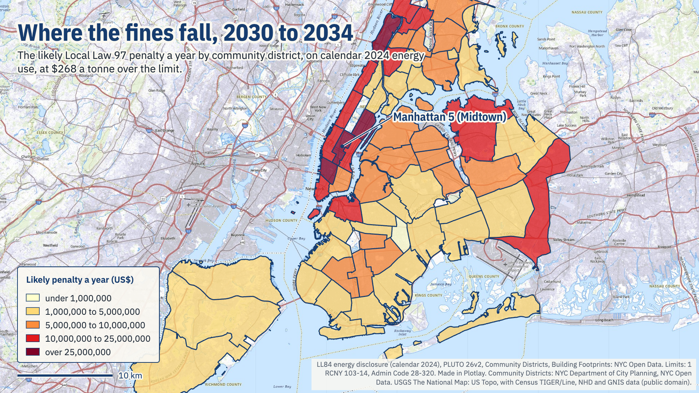
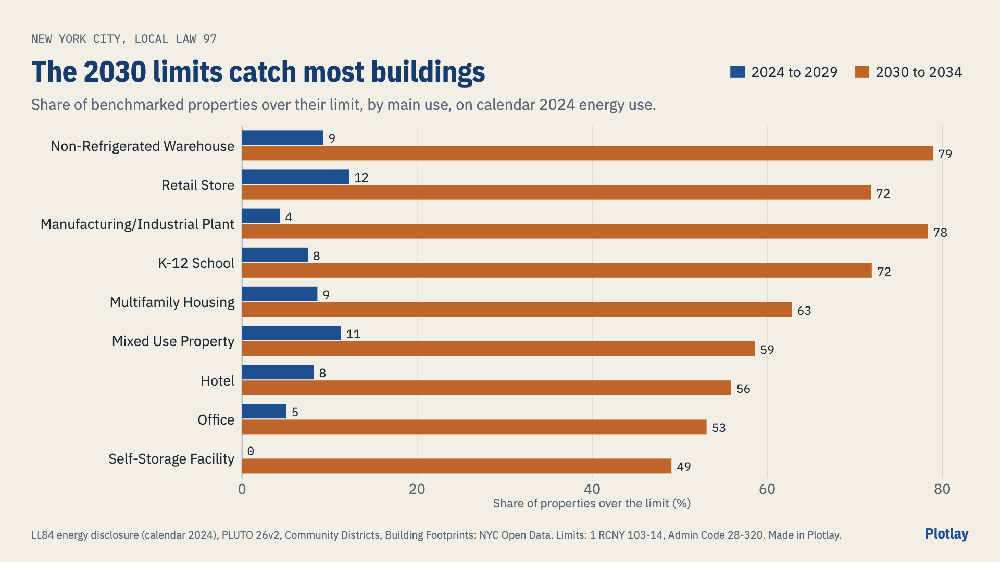

# Which New York City buildings face Local Law 97 fines?

Each benchmarked building's emissions against its Local Law 97 limit, from the city's own energy data. **Live version, with an interactive map:** [getplotlay.com/showcase/nyc-local-law-97](https://www.getplotlay.com/showcase/nyc-local-law-97/)



Local Law 97 of 2019 caps the greenhouse gas emissions of most New York City buildings over 25,000 square feet. From 2024 a building over its cap pays **$268 for each tonne of CO2e over, every year**, and the caps tighten in 2030. On what they used in calendar 2024, **1,830 of 21,753 benchmarked properties (8.4%) are over their 2024 to 2029 limit: about $58.6 million a year.** With the same energy use, **13,546 (62.3%) would be over the 2030 to 2034 limit: about $532.8 million a year.**

The city publishes what each large building used (the Local Law 84 energy and water disclosure), but not its limit, its emissions as Local Law 97 counts them, or a shape to map it by. The limits and penalties here were worked out from the law's own factors and coefficients, and the community districts and Midtown's buildings were keyed to the data in [Plotlay](https://www.getplotlay.com).

[](https://app.plotlay.io/?example=nyc-local-law-97&as=client)

## What the data says

Calendar year 2024 (LL84 records with report year 2024, published 25 November 2025), the 21,753 properties in the totals: on the standard pathway (Article 320) and passing the data checks.

| | 2024 to 2029 | 2030 to 2034 (same energy use) |
|---|---|---|
| Properties over their limit | 1,830 (8.4%) | 13,546 (62.3%) |
| Likely penalty a year | $58.6M | $532.8M |
| Tonnes of CO2e over | 218,558 | 1,988,174 |
| Median penalty, when over | $13,598 | $17,442 |
| Properties over $1 million a year | 4 | 21 |
| Manhattan Community District 5 (Midtown) | 113 of 1,507 over, $4.8M | 869 over, $62.1M |

- **2030 is the cliff.** 11,719 properties under their limit today are over it in 2030 if nothing changes. Multifamily housing goes from 8.6% over to 62.7%, offices from 5.0% to 53.2%.
- **Manhattan carries most of it.** The five community districts with the largest 2030 to 2034 bills, Manhattan 5, Manhattan 12, Manhattan 8, Manhattan 2, Manhattan 7, add up to 33.7% of the city's total. Midtown alone is 11.7%.
- **The total depends on what is counted.** Put back the 1,204 records that fail a data check and 2024 to 2029 becomes $118.8M; add every pathway and it is $265.0M. The headline counts neither.



### Read it carefully

- **An estimate, not a bill.** It is what a building would pay at $268 a tonne if its 2024 report stood as published. Owners can correct a report, use the good faith provisions for 2024 and 2025, buy renewable energy credits or apply for an adjustment, and none of that shows in open data.
- **2030 to 2034 assumes nothing changes.** It applies the 2030 limits and coefficients (grid electricity 0.000145 tCO2e per kWh instead of 0.000288962) to calendar 2024 use.
- **Matching records to lots.** 27,048 of 27,270 kept records matched a PLUTO 26v2 lot by their BBL (17 by a second BBL); 222 did not and stay in the tables with no district. A property's first matching lot gives its position and district; 99.9% of positions fall inside that district. In Midtown, 1,428 properties matched footprints by BIN, 3 by lot, and 150 have no footprint of their own (most share a building with a larger record).
- **Mixed use.** 32.2% of the properties in the totals list more than one use. The limit adds up each use's floor area times its factor, as the rule says. 930 properties have a use under a newer Portfolio Manager name or a type the rule does not list; those take the rule's successor name or its "Other" factor for the same category (`data/tables/emissions_factors.csv`, column `ll84_names`). Floor area listed as plain "Other" takes the average factor of the property's other uses.
- **Pathways.** 4,473 kept properties are likely on another compliance route and are left out of the totals: city-owned 1,737, tax-exempt housing (likely income-restricted or Mitchell-Lama, with later deadlines) 1,163, HDFC 942, NYCHA 237, state or federal 224, houses of worship 170. These are flags from PLUTO's owner type and name, not facts. Rent-regulated buildings (more than 35% of units) also follow Article 321 and cannot be told apart in open data, so some multifamily properties in the totals will not face these penalties.
- **Data checks.** A record whose site energy per square foot is more than three times, or under a quarter of, the median for its property type (1,135 records), or whose emissions differ from Portfolio Manager's own figure by more than half (69), stays in the tables and out of the totals. 62.9% of the properties in the totals carry an estimated or default value somewhere in the record (flag `estimated_any`).
- **Left out.** Of 39,090 records: 9,988 child records whose parent record (holding their energy) is also there, 1,291 with no energy reported, 209 with site energy under 5 or over 1,000 kBtu per square foot, 252 not existing or unoccupied, 80 with no usable floor area by use. Each is in `data/tables/excluded.csv` with its reason.

## How it was made with Plotlay

1. **A map project** on the USGS National Map topo base map (public domain), and two **Data layers** ([Data layers](https://www.getplotlay.com/features)).
2. **Community districts: pick from a layer.** The City Planning districts file, with its licence; one click per district (59), then **Keys from a field**: each shape takes its own `boro_cd` (101 to 503).
3. **Place rows by their position.** Every property in the totals, at its PLUTO latitude and longitude, falls into the district it stands in. Both periods are rows of one table, so the period is the **time axis** and the slider steps from 2024 to 2029 to 2030 to 2034.
4. **Colour** by the share of properties over the limit (the average of `over_limit`) and by the likely penalty (the total), breaks set by hand, Yellow orange red.
5. **Midtown buildings.** The city's footprints for Manhattan Community District 5, imported with their columns, copied into a second layer and keyed by their LL84 `property_id` in one step: 1,530 building outlines, 1,431 properties, buildings of one property joined as parts of one key.
6. **Link by key, colour and leave out.** The Midtown table by `property_id`, coloured by the likely penalty on the period slider, properties on another pathway or failing a check left out in grey with their own legend row.
7. **3D at the real heights.** Each footprint at its roof height (`height_m`, from the city's `height_roof` in feet).
8. **Export** GeoJSON, TopoJSON, CSV with WKT and the linked data, for Power BI and Python. Nothing in this repository comes from OpenStreetMap, and no imagery was traced.

## What's here

| Folder | What |
|---|---|
| [`data/geometry/`](data/geometry) | The 59 community districts and Midtown's building footprints from Plotlay: GeoJSON, TopoJSON, CSV with WKT. Keys: `boro_cd`, the LL84 `property_id` |
| [`data/tables/`](data/tables) | `properties.csv` (every kept property: emissions, limits and likely penalties for both periods, pathway, check), `properties_by_period.csv` and `midtown_by_period.csv` (what the app linked), `excluded.csv`, `emissions_factors.csv`, `coefficients.csv`, `community_districts.csv` |
| [`python/`](python) | A narrated notebook that recomputes every number here: [`local_law_97.ipynb`](python/local_law_97.ipynb) |
| [`powerbi/`](powerbi) | A Power BI Project (`.pbip`). Start with [`powerbi/OPEN-ME.md`](powerbi/OPEN-ME.md) |
| [`visuals/`](visuals) | The map pictures and charts, made in Plotlay from the same layers (one, what the total depends on, by its chart engine from a table of the three totals) |

### Run the notebook

```
python3 -m venv .venv
.venv/bin/pip install -r python/requirements.txt
cd python && ../.venv/bin/jupyter lab local_law_97.ipynb
```

### Open the Power BI report

Open `powerbi/NYCLocalLaw97.pbip` in Power BI Desktop and select Refresh. [`powerbi/OPEN-ME.md`](powerbi/OPEN-ME.md) has the steps, including the two map settings Power BI asks for by hand.

## Sources and licences

- **Code** (notebook, Power BI project): MIT, see [`LICENSE`](LICENSE).
- **Our data** (the tables, the shapes, the checks): CC BY 4.0, see [`LICENSE-DATA`](LICENSE-DATA). Credit "Plotlay (getplotlay.com)" and NYC Open Data.
- NYC Building Energy and Water Data Disclosure for Local Law 84 (calendar 2024), PLUTO 26v2, Community Districts and Building Footprints: NYC Open Data. New York City's Open Data Law makes public data sets available "without any registration requirement, license requirement or restrictions on their use", asking users to identify the source and version and describe any changes (Admin Code 23-502 (d)); this README and [`NOTICE`](NOTICE) do. The city gives no warranty of their accuracy (23-504).
- The rules: Local Law 97 of 2019 (Admin Code 28-320) and the Department of Buildings rule 1 RCNY 103-14, quoted in `data/tables/emissions_factors.csv` and `coefficients.csv`.
- Base map in the app: USGS The National Map, US Topo (public domain).

This is independent work using open data, not endorsed by the City of New York or any of its agencies. Full credits are in [`NOTICE`](NOTICE).
